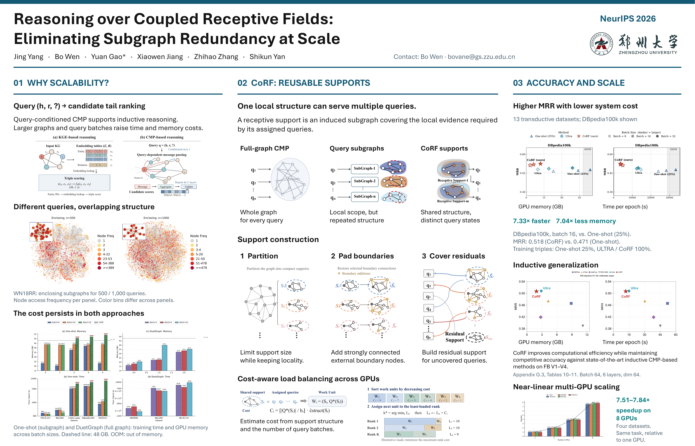

# CoRF: Reasoning over Coupled Receptive Fields

This repository accompanies the NeurIPS 2026 paper **Reasoning over Coupled Receptive Fields: Eliminating Subgraph Redundancy at Scale**.

**Authors:** Jing Yang, Bo Wen, Yuan Gao, Xiaowen Jiang, Zhihao Zhang, and Shikun Yan.



## Overview

Conditional message-passing methods often extract a separate local subgraph for each query. These subgraphs can overlap substantially, leading to repeated access and processing of the same graph structures. CoRF addresses this redundancy by constructing reusable receptive supports that allow multiple training queries to share local structures.

CoRF combines receptive support construction with boundary padding and residual compensation to preserve connectivity and query coverage. It also uses cost-aware load balancing to improve distributed execution.

## Code availability

The repository currently includes [`partition_utils.py`](partition_utils.py), a partitioning dispatcher used to select and coordinate graph partitioning methods. Additional implementation files, dataset preparation, configurations, and usage instructions are being prepared for release.

## Citation

If you use this work, please cite:

```bibtex
@inproceedings{yang2026corf,
  title     = {Reasoning over Coupled Receptive Fields: Eliminating Subgraph Redundancy at Scale},
  author    = {Yang, Jing and Wen, Bo and Gao, Yuan and Jiang, Xiaowen and Zhang, Zhihao and Yan, Shikun},
  booktitle = {Advances in Neural Information Processing Systems},
  year      = {2026}
}
```
